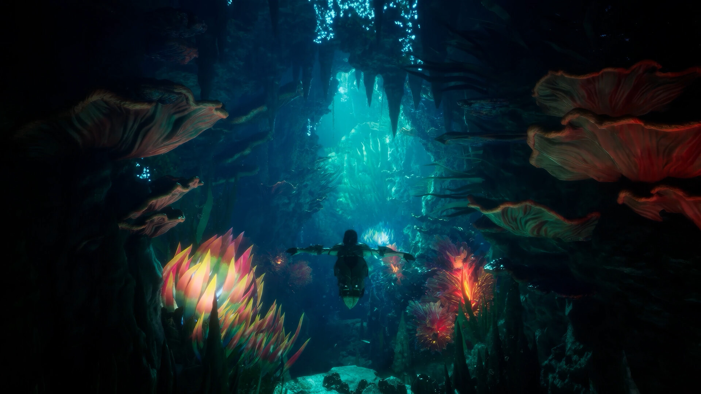
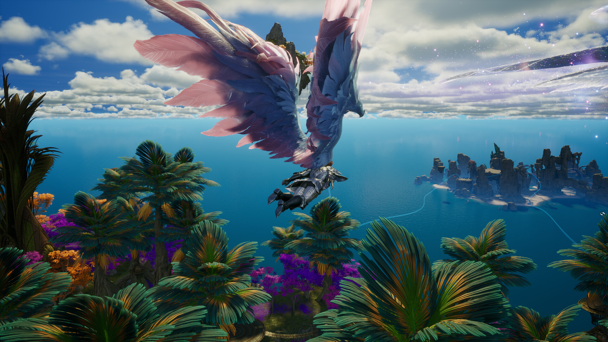
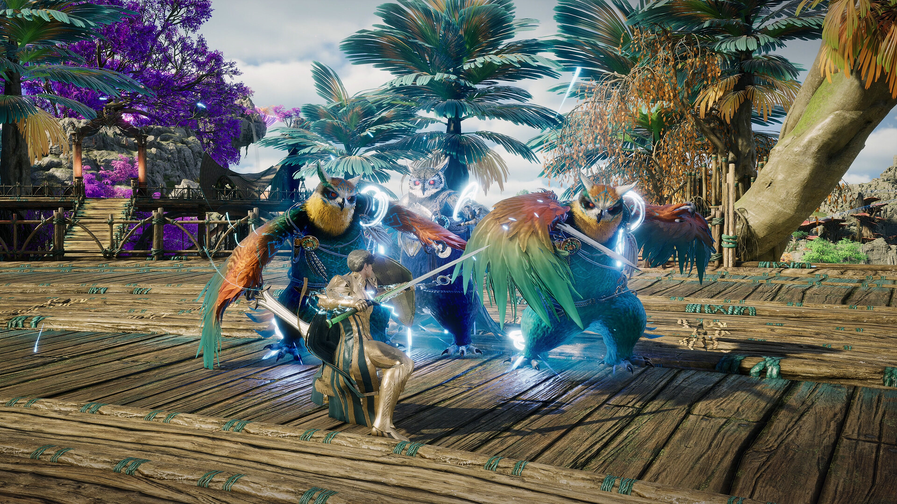

# AION 2 Beta Program 2026 — Game Enhancer for Windows

   

---

AION-2-Beta-Program-2026 puts you inside the next chapter of Atreia before the servers go live. Test the flight system, stress the faction-warfare meta, and push dungeons to their limits while the build is still hot. Every session you log feeds directly back into the game's development, and every tester who sees it through earns a free key at launch. No gimmicks, no points grind — just early access and a real say in what ships.

## About AION 2 Beta Program 2026

AION 2 is the next chapter for Atreia — a free-to-play fantasy MMORPG where Elyos and Asmodians pick up the fight all over again. Players roll a faction, build out a Daeva, take to the skies with AION's signature flight system, and grind through class-based combat, co-op dungeons, and full-scale faction warfare. The beta program exists for one reason: to put the game in real players' hands before launch and let that feedback do the work.

This isn't a demo tour. Testers get in early, break things, and file the kind of reports that actually move the needle. The payoff is real — everyone who completes the beta gets a free game key for AION 2 when it officially releases.

AION 2 is built for MMORPG players who want a big fantasy world, deep class progression, aerial exploration, and realm-vs-realm PvP that doesn't let up.

⚡ **This is an exclusive beta test opportunity.** Early access, a real say in how Atreia takes shape, and a free game key at launch — that's the deal.

## What Testers Get

- 🎟️ **Free Game Key** — Finish the beta and lock in a full copy of AION 2 on the house when it goes live. No points, no hoops, no fine print.
- 🪽 **Day-One Flight Time** — Get into Atreia before the servers fill up. Fly, glide, and explore the world ahead of the public rush.
- ⚔️ **Real Influence** — Your feedback goes straight to the dev team. Balance calls, combat pacing, dungeon tuning — testers move the needle, not the comment section.
- 🛡️ **Early Class Access** — Roll a Daeva, push every class through its paces, and stress-test the combat loop while it's still being sharpened.
- 🏰 **Dungeon & Faction Playtests** — Squad up for dungeon runs and large-scale Elyos-vs-Asmodian scraps before they're locked in stone.
- 🤝 **Tester Status** — Verified beta access tied to your Steam profile. No sketchy downloads, no third-party launchers, just the build and your feedback.
- 🚀 **A Head Start on Launch** — Know the maps, the metas, and the matchups before everyone else spawns in.

## How to Join the Beta

**Step 1: Sign in with Steam**

- Open the AION 2 Beta Program 2026 repository and hit the sign-in prompt.
- Authenticate through Steam's official login — no passwords stored, no sketchy credential handoffs. Your account stays yours.

**Step 2: Get Approved**

- After signing in, your tester profile goes into review.
- Approvals roll out as slots open up, roughly once a week. Patience, Daeva — the gates open on schedule.

**Step 3: Request Your Key**

- Once approved, claim your spot in the AION 2 beta and lock in your free game key.
- One key per tester. No alt-account farming, no gimmicks.

**Step 4: Play & Shape Atreia**

- Download the beta build, pick your faction, and put the flight system and class combat through their paces.
- Report bugs, flag balance issues, and drop honest feedback — that's the whole point of a beta.

**Step 5: Earn Your Reward**

- Complete the beta and your free game key lands at release.
- Test, report, repeat. Your reward is the game itself.

## 📸 Screenshot

## System Requirements

Before you dive into Atreia, make sure your rig can handle the flight. These are the specs you'll need to run the AION 2 beta build smoothly — no guesswork, no surprises.

**Minimum specs — you're in, but expect some compromise:**

- **OS:** Windows 10 64-bit
- **Processor:** Intel Core i5-8400 or AMD Ryzen 5 2600
- **RAM:** 16 GB
- **Graphics:** NVIDIA GeForce GTX 1660 or AMD Radeon RX 5600 XT
- **Storage:** 100 GB available space
- **Additional:** DirectX 12 and a broadband internet connection

**Recommended specs — this is where Atreia really opens up:**

- **OS:** Windows 11 64-bit
- **Processor:** Intel Core i7-10700 or AMD Ryzen 7 3700X
- **RAM:** 32 GB
- **Graphics:** NVIDIA GeForce RTX 3060 or AMD Radeon RX 6700 XT
- **Storage:** 100 GB available space on an SSD
- **Additional:** DirectX 12, broadband internet, and the Visual C++ Redistributable 2022

A few things worth calling out. The beta build is a working test version, so performance can shift between updates — if you're sitting right at the minimum line, expect the occasional frame dip during large-scale faction fights. An SSD isn't just a nice-to-have for load times; it genuinely changes how the open world streams in. And keep your GPU drivers current before you report anything, because outdated drivers are the number one source of false bugs.

Meet the minimums and you're cleared to test. Hit the recommended tier and you'll experience the beta the way it's meant to fly.

## FAQ

**Q: What is the AION 2 Beta Program 2026?**

**A:** It's the official testing window for AION 2 ahead of launch. Testers get hands-on time with the build, direct influence over balance and content, and a free game key for the full release. You're not just playing early — you're helping build Atreia.

**Q: What do I actually get for testing?**

**A:** A free game key for AION 2 at official launch, plus early access to the beta build and a direct line to the devs via feedback. Your reward is the game itself — no points, no gimmicks.

**Q: Does it cost anything to join?**

**A:** Nothing. The program is completely free. All it asks for is your time and honest feedback.

**Q: How do I get in?**

**A:** Sign in with your Steam account, get your tester profile approved, then request access to the AION 2 beta. Approvals roll out as spots free up — roughly once a week.

**Q: Is my Steam account safe?**

**A:** Yes. Sign-in runs through Steam's official authentication, so your password is never seen or stored. Your account stays fully under your control.

**Q: When do I get my key?**

**A:** Keys go out via email once AION 2 officially launches. Watch the email tied to your Steam account.

**Q: Will I get access right away?**

**A:** Not instantly. Your tester profile needs approval first, and spots open on a rolling basis. Once you're approved, the beta becomes visible and requestable.

**Q: Is my PC going to run it?**

**A:** Check the System Requirements above before you request access. AION 2 wants a 64-bit Windows 10/11 setup, a solid mid-range GPU, 16 GB RAM minimum, and 100 GB of storage — SSD strongly recommended.

**Q: What kind of feedback are you looking for?**

**A:** Everything that matters: combat feel, class balance, flight controls, dungeon difficulty, faction PvP pacing, performance, and bugs. Specific, honest reports shape the launch build.

## Disclaimer

Read this straight: the AION-2-Beta-Program-2026 is a fan-run, community beta initiative — not an official NC or AION 2 publication, and not affiliated with or endorsed by the game's developer or publisher. All game names, logos, and trademarks belong to their respective owners and are referenced here for identification purposes only.

Beta access is limited and granted at the program's discretion. Spots open as capacity allows, and requesting access does not guarantee approval. Free game keys are issued for the full release on the official storefront and are tied to completed beta participation — they are not a pre-order, a purchase, or a promise of early launch access. Timelines can shift; betas slip, builds change, and release windows move. That's the nature of testing.

Your Steam account security is on you — never share your password, and only authorize sign-in through the official Steam flow. Feedback you submit is used to improve the game and may be shared with the development team. We don't sell your data, and we don't store credentials.

By taking part, you accept that beta builds are unfinished software: expect bugs, balance swings, wipes, and downtime. Nothing here is a contract, and nothing in this repository should be read as a guarantee of rewards, access, or outcomes. If you're not comfortable with any of that, don't join — this program is for players who want to test hard and report honestly.

Test smart. Play fair. See you in Atreia.

